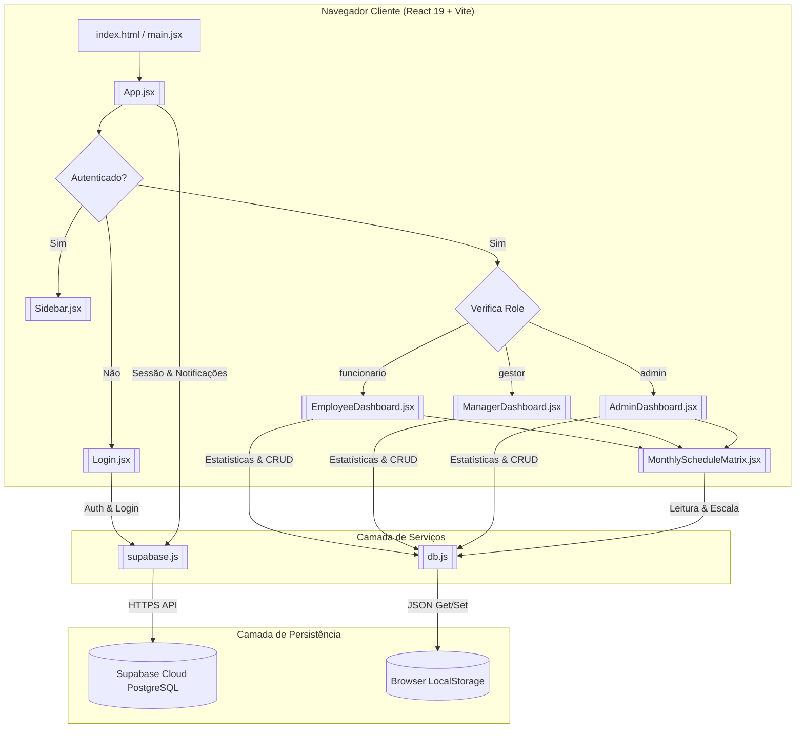

# Arquitetura Geral

## O que é
O documento de **Arquitetura Geral** descreve a estrutura física e lógica do software, os fluxos de dados entre a interface e os serviços de persistência, e as camadas responsivas do sistema Coco Bambu.

## Para que serve
Serve como mapa de referência para entender a topologia da aplicação, a comunicação entre o cliente React e os serviços de dados ([[Supabase Service]] e [[DB Service Mock]]), bem como o roteamento de telas baseado em estado global de autenticação e papéis de usuário.

## Onde está
Localização na documentação: `docs/01-Arquitetura/Arquitetura Geral.md`.

## Do que depende
A arquitetura do projeto depende fundamentalmente de:
- **Vite & React 19**: Ecossistema de transpilação e renderização da aplicação no navegador.
- **[[Supabase Service]]**: Serviço remoto para autenticação e gestão de perfis (`profiles`).
- **[[DB Service Mock]]**: Serviço local singleton (`LocalSupabaseMock`) para persistência de tabelas operacionais em `localStorage`.
- **Lucide React**: Biblioteca de ícones visuais consumida por todos os componentes.

## Quem depende dele
- Todos os módulos ([[Módulo de Autenticação e Sessão]], [[Módulo de Avaliações e Quizzes]], etc.) e componentes ([[App]], [[Sidebar]], [[AdminDashboard]], etc.) seguem os padrões definidos nesta arquitetura.

## Como funciona

A aplicação adota uma estrutura em 3 camadas principais:

1. **Camada de Apresentação (View Layer)**:
   - [[App]]: Raiz do componente React que controla o estado do usuário logado (`currentUser`) e a aba ativa (`currentTab`).
   - [[Sidebar]]: Menu dinâmico lateral que renderiza itens específicos de acordo com a `role` (`funcionario`, `gestor`, `admin`).
   - Dashboards especializadas: [[EmployeeDashboard]], [[ManagerDashboard]] e [[AdminDashboard]].
   - Componentes auxiliares: [[Login]], [[MonthlyScheduleMatrix]].

2. **Camada de Serviços e Regras de Negócio (Service Layer)**:
   - [[Supabase Service]]: Comunicação remota HTTP/WebSockets via cliente oficial `@supabase/supabase-js`.
   - [[DB Service Mock]]: Classe JavaScript `LocalSupabaseMock` exportando a instância `db` que realiza leitura/escrita síncrona em `localStorage`, agrupando cálculos de estatísticas (`getManagerStats`, `getAdminStats`).

3. **Camada de Persistência e Dados (Data Layer)**:
   - **Supabase Cloud (PostgreSQL)**: Armazena usuários (`auth.users`), perfis (`profiles`) e relacionamentos de unidades/setores.
   - **Navegador LocalStorage**: Armazena as chaves prefixadas `capybara_academy_*` (`capybara_academy_activities`, `capybara_academy_work_schedules`, etc.).

### Diagrama Arquitetural da Aplicação

## O que pode quebrar se ele for alterado
- **Contrato de Interfaces**: Alterar a assinatura de exportação do cliente [[Supabase Service]] ou do objeto `db` em [[DB Service Mock]] interrompe o funcionamento de todas as dashboards simultaneamente.
- **Roteamento Interno**: Alterar a lógica de estados `currentTab` em [[App]] pode deixar a interface sem componentes renderizados ou exibir abas incompatíveis com o papel do colaborador.
- **Perda de Dados LocalStorage**: Modificar as chaves de prefixo `DB_KEY_PREFIX` em `db.js` fará com que o sistema reinicie os dados mock sem ler o estado atual do usuário.

## Arquivos relacionados
- `src/main.jsx`
- `src/App.jsx`
- `src/services/supabase.js`
- `src/services/db.js`
- `src/components/Sidebar.jsx`
- `src/components/Login.jsx`
- `src/components/AdminDashboard.jsx`
- `src/components/ManagerDashboard.jsx`
- `src/components/EmployeeDashboard.jsx`
- `src/components/MonthlyScheduleMatrix.jsx`
