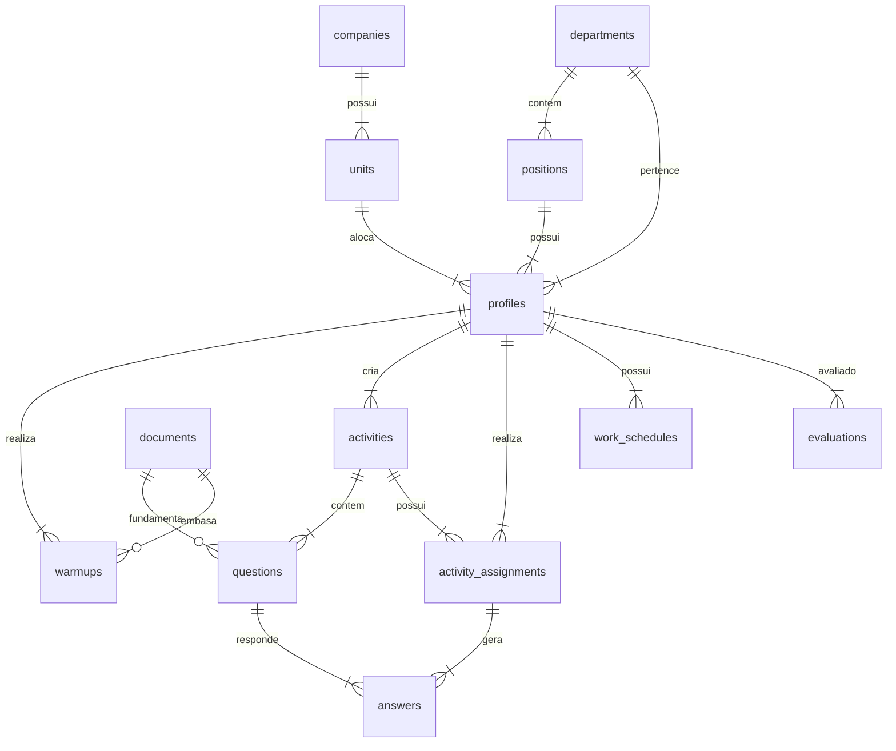

# Modelo de Dados e Tabelas

## O que é
O **Modelo de Dados e Tabelas** descreve a estrutura relacional do sistema Coco Bambu, abrangendo as 15 tabelas que compõem o banco de dados operado pela aplicação (tanto no Supabase quanto no serviço de persistência mock em [[DB Service Mock]]).

## Para que serve
Fornece a especificação completa de entidades, chaves primárias, chaves estrangeiras, campos, papéis de acesso e relacionamentos para desenvolvedores e administradores do banco de dados.

## Onde está
- Código-fonte de simulação local: `src/services/db.js`
- Cliente de banco de dados remoto: `src/services/supabase.js`
- Script SQL completo para criação no Supabase: `schema_completo.sql` (disponível nos artefatos do projeto)

## Do que depende
- **Supabase PostgreSQL** (no ambiente de produção/homologação).
- **LocalStorage do Navegador** (no ambiente de desenvolvimento/demo local via `db.js`).

## Quem depende dele
- Todos os serviços ([[DB Service Mock]], [[Supabase Service]]) e componentes ([[App]], [[AdminDashboard]], [[ManagerDashboard]], [[EmployeeDashboard]], [[MonthlyScheduleMatrix]]).

---

## Mapeamento das Tabelas Identificadas

| # | Tabela | Descrição e Finalidade |
|---|---|---|
| 1 | `companies` | Cadastro da empresa mantenedora (ex: Coco Bambu). |
| 2 | `units` | Filiais e unidades operacionais do restaurante (ex: Teresina, Matriz). |
| 3 | `departments` | Setores funcionais do restaurante (Atendimento, Cozinha, Bar, RH, Gestão). |
| 4 | `positions` | Cargos exercidos pelos colaboradores vinculados aos setores (Garçom, Cozinheiro, Barman, etc.). |
| 5 | `profiles` / `users` | Tabela estendida de usuários e colaboradores com privilégios (`role`), setor e unidade. |
| 6 | `documents` | Biblioteca de manuais de procedimentos (POPs), fichas técnicas e guias operacionais. |
| 7 | `trainings` | Agenda de capacitações e treinamentos presenciais ou virtuais marcados para as unidades. |
| 8 | `warmups` | Registros diários dos briefings de alinhamento pré-turno ("Esquenta"). |
| 9 | `activities` | Provas teóricas e quizzes cadastrados por gestores e administradores. |
| 10 | `questions` | Questões de múltipla escolha associadas a cada atividade, contendo 4 opções e justificativa. |
| 11 | `activity_assignments` | Vínculo da atividade atribuída ao colaborador, contendo status, nota obtida e data de conclusão. |
| 12 | `answers` | Respostas individuais marcadas por cada colaborador para cada questão da prova. |
| 13 | `work_schedules` | Grade mensal de turnos (Almoço, Jantar, Intermediário) e folgas por colaborador e data. |
| 14 | `evaluations` | Fichas de avaliação de desempenho periódica dos colaboradores realizadas pelos gestores. |
| 15 | `notifications` | Mensagens e alertas internos enviados aos colaboradores (ex: novo exame, resultado de prova). |

---

## Diagrama de Relacionamentos (ER)

---

## Detalhamento de Estrutura de Tabelas Relevantes

### 1. `profiles` / `users`
- `id` (UUID / String): Chave primária (no Supabase vincula a `auth.users.id`).
- `name` (String): Nome completo do colaborador.
- `email` (String): E-mail corporativo.
- `role` (String): Nível de permissão (`admin`, `gestor`, `funcionario`).
- `unit_id` (FK -> `units.id`): Unidade do colaborador.
- `department_id` (FK -> `departments.id`): Setor do colaborador.
- `position_id` (FK -> `positions.id`): Cargo ocupado.
- `status` (String): Estado da conta (`active`, `inactive`).

### 2. `activities`
- `id` (String): ID único da atividade.
- `title` (String): Título do exame.
- `theme` (String): Tema abordado.
- `sector_id` (FK -> `departments.id`): Setor alvo.
- `target_audience` (String): Público-alvo (ex: "Atendimento", "Todos").
- `deadline` (Date): Data limite para entrega.
- `material_id` (FK -> `documents.id`): Manual de referência.
- `status` (String): Estado (`draft`, `published`, `archived`).
- `manager_id` (FK -> `profiles.id`): Gestor criador.
- `unit_id` (FK -> `units.id`): Filial restrita.

### 3. `questions`
- `id` (String): ID da questão.
- `activity_id` (FK -> `activities.id`): Atividade relacionada.
- `question_index` (Integer): Ordem da pergunta.
- `question_text` (Text): Enunciado da questão.
- `option_a`, `option_b`, `option_c`, `option_d` (Text): Alternativas.
- `correct_option` (Char): Opção correta ('A', 'B', 'C' ou 'D').
- `explanation` (Text): Explicação pedagógica exibida após a resposta.
- `guide_id` (FK -> `documents.id`): Documento em que se fundamenta.

---

## Autenticação e Políticas de Acesso (RLS)

No banco Supabase PostgreSQL real:
- **Autenticação**: Gerenciada pelo módulo `auth.users`.
- **Triggers**: Ao criar um usuário no Auth, uma trigger cria automaticamente um registro na tabela `profiles`.
- **Row Level Security (RLS)**:
  - `admin`: Possui permissão `ALL` em todas as tabelas.
  - `gestor`: Possui permissões de leitura/escrita restritas aos registros da sua própria unidade (`unit_id`).
  - `funcionario`: Possui permissão de leitura em manuais/atividades publicadas da sua unidade/setor e escrita apenas nas tabelas de suas próprias respostas (`answers`) e tarefas atribuídas (`activity_assignments`).

## Arquivos relacionados
- `src/services/db.js`
- `src/services/supabase.js`
- `src/App.jsx`
- [[DB Service Mock]]
- [[Supabase Service]]
